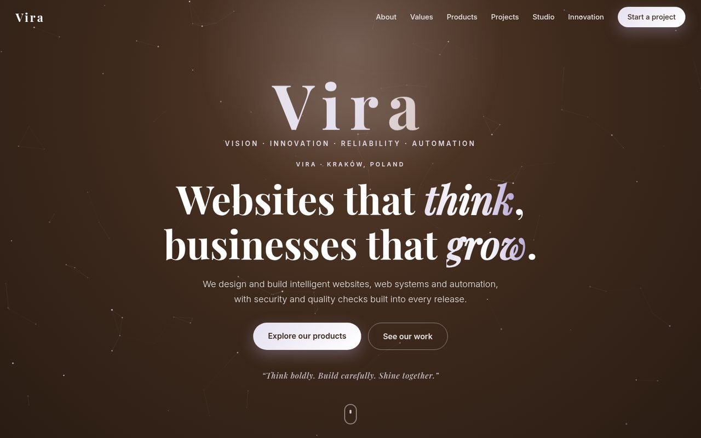

# Vira

**Vision · Innovation · Reliability · Automation**

A technology studio site for intelligent websites, web systems, and automation, with security and quality review built into every release. Based in Kraków, Poland.

[](https://arnold-rg.github.io/vira/)

**Live:** [https://arnold-rg.github.io/vira/](https://arnold-rg.github.io/vira/)

[](https://arnold-rg.github.io/vira/)

## What it is

Vira is a static public website. It explains the studio’s values, services (websites, web systems, automation, security and QA), and a selection of shipped projects. The name comes from the Sanskrit *vīra* (hero, brave, strong) and the Latin roots of *virtus* (courage, excellence, integrity). It also stands for **Vision, Innovation, Reliability, Automation**.

## Features

- Responsive marketing site that works on phones and desktop browsers
- Wordmark identity in Mocha, Platinum, and Lavender
- About, values, products, projects, studio gallery, and a project-inquiry section
- Static hosting on GitHub Pages (no account required to visit)

## Tech stack

| Layer | Tools |
| --- | --- |
| Markup & style | HTML5, CSS3, vanilla JavaScript |
| Hosting | GitHub Pages, from the `main` branch root |
| Photography | Unsplash (credited on the site) |

## Getting started

```bash
git clone https://github.com/Arnold-RG/vira.git
cd vira
python3 -m http.server 8000
```

Open [http://127.0.0.1:8000/](http://127.0.0.1:8000/).

## Project structure

```text
index.html       Site markup
css/             Design tokens, base, components and sections
js/              Theme, motion, pricing, form and gallery modules
assets/          Photographs, logos, self-hosted fonts and hero video
docs/            README screenshot
```

## Tests

This is a static site with no automated test suite.

## Author

Arnold Rurangwa
